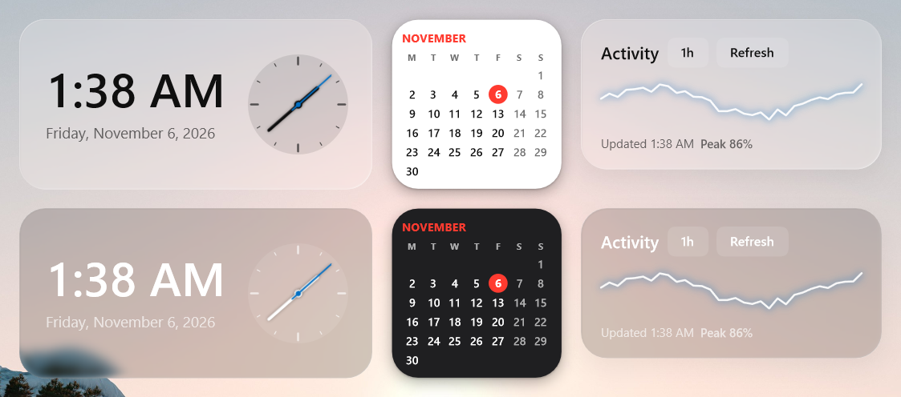
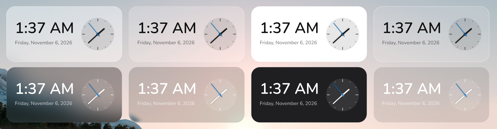

# widget-engine

**Beautiful, native desktop widgets for Windows 11. Designed in minutes, rendered on the GPU,
idle at 0% CPU.**

widget-engine is the fastest way to put your app on the user's desktop. Describe a widget in
two small text files, and the engine does the rest: liquid-glass materials, smooth
compositor animations, light and dark themes, per-monitor DPI, a polished settings menu and
desktop behavior that feels like it shipped with Windows.



## Performance

Widgets live on the desktop all day, so the engine is built to be invisible in Task Manager.

| Metric | Result |
|---|---|
| Memory, 5 widgets on the desktop | **about 90 MB of RAM** |
| CPU while idle | **0%** (0.02% measured over 30 s, with a clock showing seconds) |
| CPU for animations | **0%**: second hands, springs and fades run in the DirectComposition compositor |
| Engine size | **1.2 MB** `widget.dll`; a full widget app with 40+ widgets is a 2.1 MB exe |
| Runtime dependencies | **None.** No WebView, no Electron, no .NET, no browser engine |
| Redraws | Only what changed, only when it changes |

How it stays this light:

- **Native from top to bottom.** D3D11, Direct2D, DirectWrite and DirectComposition through
  `windows-rs`, in Rust. Four crate dependencies, no UI framework.
- **Sleeps until something changes.** No render loop and no polling: the engine wakes for a
  new minute, a new value from your app or the user's pointer.
- **The compositor animates.** Rotations, opacity and spring scales are handed to the system
  compositor, which runs them without waking your process.
- **Memory stays flat.** Most of the footprint is the shared GPU device; every extra widget
  adds only a few megabytes.

## Why widget-engine

### Create a widget in minutes

- **Two text files.** `widget.toml` describes the widget, `layout.xml` draws it. No code
  needed for a clock, a calendar or a widget your app feeds.
- **One command to start:** `widget-dev new widgets/hello` writes a working widget to edit.
- **Live reload.** Save a file and the widget on the desktop updates instantly. Mistakes
  print with the file and line, and the last good version stays on screen.
- **Autocomplete in your editor.** JSON Schema and XML Schema ship with the engine, so VS Code
  and friends complete every element and attribute and flag errors as you type.
- **Familiar layout.** Rows, columns and stacks with flexbox-style `grow`, `gap`, `padding`
  and alignment. Bindings like `{clock.time}` or `{app.temp}` fill in live data.

### Looks stunning out of the box

- **Liquid glass.** The backdrop refracts through a real glass bezel (Snell's law on a
  squircle profile), with color dispersion and a specular rim.
- **Frosted, solid and clear materials** that show the wallpaper and desktop icons behind
  them, with continuous rounded corners, hairline borders and soft shadows.
- **Rich styling:** linear, radial and conic gradients, layered shadows, SVG and raster images,
  OpenType features, hover and pressed states, spring transitions.
- **Always on theme.** Widgets follow light and dark mode and the Windows accent color, and stay
  pixel-sharp on every monitor and DPI.
- **No limits.** When markup is not enough, a `<canvas>` hands you the raw
  `ID2D1DeviceContext`.

### Users love customizing it

- **A polished right-click menu** with exactly what you allow: size from Small to Huge,
  material, transparency, blur, tint, corners, shadow, theme, font, accent and text colors,
  plus your widget's own options.
- **Translated.** The menu follows the Windows display language in 12 languages, and your
  widget's texts translate through simple `[strings.<language>]` tables.
- **Remembers everything.** Positions and choices are saved per widget instance.

### Behaves like part of Windows

- Lives on the desktop below every window, next to the icons.
- Double-click and hold to move; snaps to screen edges and to other widgets and stays inside
  the work area.
- Hides while a fullscreen game or video runs on its monitor.
- Survives Explorer restarts, DPI changes and GPU resets.

### Fits any app

- **Rust:** the `widget-engine` crate, three lines to show a widget.
- **C and every other language:** `widget.dll` and `widget.h`.
- **Ship into [Calmdesk](https://github.com/rom5n/calmdesk):** the widget gallery for Windows 11.
  Your app installs a package folder and sends values; Calmdesk shows it next to every other
  widget, with the same look and settings menu.

The same clock package in every material, light theme on top and dark below: frosted,
liquid glass, solid and clear.



## Quick start (10 minutes)

The step-by-step [guide](docs/guide.md) goes from an empty folder to a widget your app feeds
and ships into [Calmdesk](https://github.com/rom5n/calmdesk).

Needs Windows 11, Rust 1.85+ and the MSVC build tools.

```bash
git clone https://github.com/rom5n/widget-engine.git widget && cd widget
cargo run -p widget-engine --example clock --release
```

The clock appears in the top right corner of your desktop. Right-click it for settings,
double-click and hold to move it, press Esc on it to quit. More examples:

```bash
cargo run -p widget-engine --example calendar --release
```

```bash
cargo run -p widget-engine --example sparkline --release
```

### Your own widget

1. Copy `examples/widgets/clock` to `widgets/hello` and open it with live reload:

   ```bash
   cargo run -p widget-engine --bin widget-dev --release -- widgets/hello
   ```

2. Edit `widgets/hello/layout.xml` and save. The widget updates on the desktop:

   ```xml
   <widget>
     <column padding="20" gap="4">
       <text value="Hello, {app.name}" size="28"/>
       <text value="{clock.weekday}, {clock.time}" size="14" color="secondary"/>
       <stack padding="6 14" radius="14" fill="accent" hover.scale="1.05" transition="spring"
              action="wave">
         <text value="Wave" size="13" color="#FFFFFF"/>
       </stack>
     </column>
   </widget>
   ```

3. Host it in your app:

   ```rust
   use widget_engine::Engine;

   fn main() -> widget_engine::windows::core::Result<()> {
       let mut engine = Engine::new();
       engine.load("hello", "widgets/hello", 100, 100)?;
       engine.set("hello", "name", "World");
       engine.on_action(|widget, action| println!("{widget}: {action}"));
       engine.run()
   }
   ```

Editors pick up `schemas/widget.schema.json` (TOML, via the `#:schema` comment) and
`schemas/layout.xsd` (XML) for completion and errors as you type.

### From C

```c
#include "widget.h"

WeEngine *engine = we_engine_new();
we_load(engine, "clock", "examples/widgets/clock", 100, 100);
we_set("clock", "label", "Tokyo");
we_run(engine);
```

`examples/c-demo/build.bat` builds a complete C example against `widget.dll`.

## Docs

- [docs/guide.md](docs/guide.md): step by step, from a new package to shipping it in Calmdesk.
- [docs/authoring.md](docs/authoring.md): widget packages, layout elements, bindings, styling.
- [docs/api.md](docs/api.md): Rust and C APIs.
- [docs/rendering.md](docs/rendering.md): how the engine works inside, for contributors.
- [PLAN.md](PLAN.md): scope, milestones, budgets.

## Layout of this repository

| Path | What |
|---|---|
| `crates/engine` | The engine crate, the `widget-dev` previewer, Rust examples |
| `crates/engine-ffi` | C ABI: `widget.dll`, `include/widget.h` |
| `examples/widgets` | Packages the examples show: clock, calendar, sparkline |
| `examples/c-demo` | C app hosting two widgets |
| `examples/host-demo` | Package fed through `widget_engine::host` while [Calmdesk](https://github.com/rom5n/calmdesk) shows it (`host_demo` example) |
| `schemas/` | JSON Schema for `widget.toml`, XML Schema for `layout.xml` |

## Calmdesk

[Calmdesk](https://github.com/rom5n/calmdesk) is the desktop widget app built on this engine. It
shows every widget package it finds on the PC; see "Getting into the Calmdesk gallery" in
[docs/authoring.md](docs/authoring.md).

## License

MIT, see [LICENSE](LICENSE).
